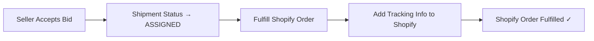
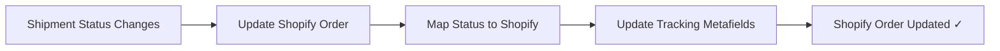

# Shopify Order Fulfillment & Status Sync

## Overview

When a seller accepts a bid for a shipment created from a Shopify order, the system now automatically:

1. ✅ **Fulfills the Shopify order** with tracking information
2. ✅ **Adds tracking details** (tracking number, URL, carrier info)
3. ✅ **Syncs status updates** as the shipment progresses through delivery

## How It Works

### 1. Accepting a Bid (Fulfillment Created)

When a seller clicks "Accept Bid" in the orders page:



**What gets sent to Shopify:**
- **Tracking Number**: Shipment ID (e.g., `cuid123abc`)
- **Tracking URL**: `{NEXT_PUBLIC_BASE_URL}/track?id={shipmentId}`
- **Carrier**: FastShip
- **Status**: PICKED_UP (initial fulfillment status)

### 2. Status Updates During Delivery

When shipment status changes (PICKUP → PICKED_UP → IN_TRANSIT → DELIVERED):



**Status Mapping:**
| FastShip Status | Shopify Status |
|---|---|
| PENDING | PENDING |
| ASSIGNED | PROCESSING |
| PICKUP | PROCESSING |
| PICKED_UP | IN_TRANSIT |
| IN_TRANSIT | IN_TRANSIT |
| DELIVERED | DELIVERED |
| FAILED | FAILED |
| CANCELLED | CANCELLED |
| RETURNED | RETURNED |

## API Endpoints

### 1. Fulfill Shopify Order

**Endpoint:** `POST /api/integrations/shopify/fulfill`

**Request:**
```json
{
  "shipmentId": "cuid123abc",
  "integrationId": "integration_456"
}
```

**Response:**
```json
{
  "message": "Shopify order fulfilled successfully",
  "trackingUrl": "http://localhost:3000/track?id=cuid123abc",
  "trackingNumber": "cuid123abc"
}
```

### 2. Update Shopify Order Status

**Endpoint:** `POST /api/integrations/shopify/update-status`

**Request:**
```json
{
  "shipmentId": "cuid123abc",
  "integrationId": "integration_456",
  "status": "IN_TRANSIT"
}
```

**Response:**
```json
{
  "message": "Shopify order status updated successfully",
  "shipmentStatus": "IN_TRANSIT",
  "shopifyStatus": "IN_TRANSIT",
  "trackingUrl": "http://localhost:3000/track?id=cuid123abc",
  "trackingNumber": "cuid123abc"
}
```

## Implementation Details

### Automatic Fulfillment (When Bid Accepted)

**File:** `app/seller/orders/page.tsx` - `handleAcceptBid` function

When a seller accepts a bid:
1. Shipment status updated to "ASSIGNED"
2. If shipment is from a Shopify order → automatically calls fulfill endpoint
3. Tracking URL and number added to Shopify order as metafields

### Automatic Status Sync (When Shipment Status Changes)

**File:** `app/api/shipments/[id]/route.ts` - PATCH endpoint

When shipment status is updated via PATCH:
1. Updates shipment in database
2. Checks for associated Shopify orders
3. Calls `updateShopifyOrderStatus()` helper
4. Updates Shopify order with new status and tracking info

### Shopify Metafields

Tracking information is stored in Shopify order metafields:

```
Namespace: fulfillment_tracking
Keys:
  - tracking_number: shipment ID
  - carrier: "FastShip"
  - tracking_url: link to tracking page
  - status: current shipment status
  - estimated_delivery: ETA (3 days from status change)
```

## Configuration Required

### Environment Variables

Make sure `.env` has:
```env
NEXT_PUBLIC_BASE_URL=http://localhost:3000
# or for production:
NEXT_PUBLIC_BASE_URL=https://fastship.com
```

This is used to generate tracking URLs sent to Shopify.

## Flow Examples

### Example 1: Order Imported from Shopify → Courier Assigned

```
1. Shopify order #1001 imported → FastShip Shipment created
2. Seller views order in /seller/orders
3. Seller clicks "Find Courier" → gets quotes
4. Seller accepts bid from CourierCo
   ↓
   - Shipment status → ASSIGNED
   - Fulfills Shopify order #1001
   - Adds tracking: shipment ID, tracking URL
   ↓
5. Seller views order in Shopify → Shows PENDING status
6. Shopify notification sent to customer with tracking
```

### Example 2: Shipment Status Updates

```
1. Courier picks up package
   - Shipment status → PICKED_UP
   - Shopify order status → IN_TRANSIT
   - Tracking updated in Shopify

2. Package in transit
   - Shipment status → IN_TRANSIT
   - Shopify order status → IN_TRANSIT
   - Tracking URL available to customer

3. Package delivered
   - Shipment status → DELIVERED
   - Shopify order status → DELIVERED
   - Delivery confirmation updated
```

## Error Handling

- **Failed to fulfill Shopify order**: Logs warning, doesn't block bid acceptance
- **Failed to sync status**: Logged as warning, shipment update still succeeds
- **Missing Shopify order**: Gracefully skips Shopify sync, shipment still updates normally
- **Invalid integration**: Returns 500 error with clear message

## Testing

### Test Fulfillment Manually

```bash
curl -X POST http://localhost:3000/api/integrations/shopify/fulfill \
  -H "Content-Type: application/json" \
  -d '{
    "shipmentId": "cuid123",
    "integrationId": "integration_456"
  }'
```

### Test Status Update Manually

```bash
curl -X POST http://localhost:3000/api/integrations/shopify/update-status \
  -H "Content-Type: application/json" \
  -d '{
    "shipmentId": "cuid123",
    "integrationId": "integration_456",
    "status": "IN_TRANSIT"
  }'
```

## Database Schema

**ShopifyOrder model** (already exists):
```prisma
model ShopifyOrder {
  id                  String
  integrationId       String
  shopifyOrderId      String     // Shopify's order ID
  shipmentId          String?    // Links to FastShip shipment
  lastStatusSyncAt    DateTime?  // When status was last synced
  // ... other fields
}
```

When an order is imported and a shipment is created, the `shipmentId` is set, enabling automatic sync.

## Future Enhancements

1. **Webhooks**: Listen for Shopify order updates and sync back to FastShip
2. **Bulk fulfillment**: Fulfill multiple orders at once
3. **Custom tracking page**: Enhanced tracking experience in Shopify
4. **Automatic refund**: Handle cancellations and refunds
5. **Inventory sync**: Update Shopify inventory on pickup
6. **Fulfillment location**: Track which warehouse handled the shipment

## Troubleshooting

### Shopify Order Not Getting Fulfilled

1. Check `ShopifyOrder` record has both `shipmentId` and `integrationId`
2. Verify integration is connected and active
3. Check API credentials in `.env`
4. Review server logs for specific error messages

### Tracking URL Not Working

1. Verify `NEXT_PUBLIC_BASE_URL` is set correctly
2. Check shipment ID matches in tracking URL
3. Ensure `/track` route exists and is accessible

### Status Not Syncing

1. Confirm shipment PATCH includes `status` field
2. Verify Shopify integration is still active
3. Check for rate limiting (Shopify API limits)
4. Review metafield namespace permissions in Shopify

## Notes

- Fulfillment happens asynchronously (doesn't block bid acceptance)
- Status updates are automatic when shipment PATCH is called
- Shopify orders can have up to 250 metafields
- Tracking URL format: `{NEXT_PUBLIC_BASE_URL}/track?id={shipmentId}`
- ETA calculated as 3 days from status update (can be customized)
